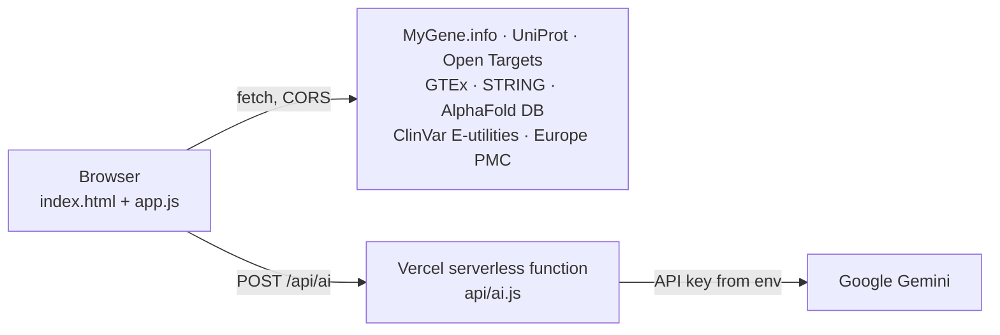

# Gene Dossier

[](https://github.com/arsennysan/gene-dossier/actions/workflows/tests.yml)
[](LICENSE)
[](https://gene-dossier.vercel.app)

**Everything about a gene on one page — in Kazakh, Russian and English.**

Type a gene symbol (TP53, BRCA1, CFTR…) and get a single dossier assembled live from eight public biological databases: what the gene does, where it is active, which diseases and variants are linked to it, its protein partners, its predicted 3D structure and the latest papers. An optional AI summary retells the page in plain language.

🔗 **Live:** https://gene-dossier.vercel.app · try [TP53](https://gene-dossier.vercel.app/#TP53), [CFTR](https://gene-dossier.vercel.app/#CFTR), [mouse Pax6](https://gene-dossier.vercel.app/#mouse:Pax6)

---

## Features

| Section | Source | What you see |
|---|---|---|
| Gene overview | MyGene.info (NCBI, Ensembl, HGNC) | Name, cytoband with a chromosome ideogram, coordinates, type, aliases, database links |
| Protein function | UniProt (Swiss-Prot) | Function text with PubMed references, length, mass, subcellular location, domains |
| Disease associations | Open Targets Platform | Top associated diseases with evidence scores |
| Tissue expression | GTEx v8 | Median TPM across 54 human tissues |
| Interaction network | STRING | Radial network of high-confidence partners; click a protein to open its dossier |
| 3D structure | AlphaFold DB + 3Dmol.js | Interactive model coloured by pLDDT confidence |
| Clinical variants | ClinVar (NCBI E-utilities) | Pathogenic → benign breakdown and the best-reviewed pathogenic variants (★ review status) |
| Recent papers | Europe PMC | Newest publications, reviews and open-access flags |
| AI summary & translation | Google Gemini (serverless) | Plain-language briefing; translation of database texts into Kazakh or Russian |

Plus:

- **Three languages** for the whole interface: Қазақша, Русский, English.
- **Expert / Student modes.** Student mode adds "in plain words" explanations: how to read a cytoband like `17p13.1`, why gene symbols are italic, what TPM or a ClinVar star means.
- **Gene comparison** side by side: shared diseases, tissues, interaction partners and whether the two proteins are directly linked in STRING.
- **Export** of the dossier to Markdown or PDF (print).
- Human, mouse and rat genes; shareable links like `#BRCA1` or `#mouse:Trp53`.
- Light and dark themes, works on phones.

## Architecture



- **No framework, no build step.** Plain HTML, CSS and JavaScript; every database is queried directly from the browser.
- **One serverless function** (`api/ai.js`) holds the AI key. It accepts only two structured tasks (summary, translation), builds the prompts itself so it cannot be used as a general chatbot, checks the request origin, rate-limits per IP and falls back between Gemini models when one is overloaded.
- **NCBI rate limit** (≈3 requests/s without a key) is respected by a single spaced request queue shared by the dossier and the comparison.
- **ClinVar "best-reviewed" list**: pathogenic records with 2+ review stars, ordered by ClinVar ID so long-studied classic variants come first.
- AI results are cached in the browser, so reopening a gene costs nothing.

## Project structure

```
index.html   page markup
style.css    design tokens (light/dark), layout, print styles
i18n.js      all interface strings in kk / ru / en
app.js       data fetching, rendering, comparison, export
api/ai.js    serverless AI endpoint (Gemini / Anthropic / Vercel AI Gateway)
tests/       jsdom page tests, AI endpoint tests, recorded database fixtures
```

## Run locally

Any static server works:

```bash
git clone https://github.com/arsennysan/gene-dossier.git
cd gene-dossier
python -m http.server 8000
```

Open http://localhost:8000. Database sections work locally; the AI buttons call the deployed endpoint.

## Tests

```bash
npm ci
npm test
```

25 tests run on Node's built-in test runner, and GitHub Actions repeats them on Node 20, 22 and 24 for every push.

- **`tests/page.test.js`** loads the real `index.html`, `i18n.js` and `app.js` in [jsdom](https://github.com/jsdom/jsdom). Every database answer comes from recorded fixtures (`tests/fixtures.js`), so the tests need no network. They cover the full TP53 dossier, expert vs student mode (cytoband explanation, PubMed links), the Kazakh/English switch, ClinVar class counts and review-star ordering, the spacing of NCBI requests, network navigation, gene comparison, the AI summary with its browser cache, translation and Markdown export.
- **`tests/ai.test.js`** calls the serverless function with a fake Gemini. It covers origin checks, input validation, prompt construction, fallback to another model on overload, JSON extraction, model pinning, the "not configured" case and the per-IP rate limit.

## Deploy your own copy

1. Import the repository into [Vercel](https://vercel.com/new) (framework preset: *Other*, no build command).
2. In **Settings → Environment Variables** add one of:
   - `GEMINI_API_KEY` — free key from [Google AI Studio](https://aistudio.google.com/apikey) (no card needed); optional `GEMINI_MODEL` to pin a model;
   - `ANTHROPIC_API_KEY` — uses Claude Haiku;
   - nothing — falls back to Vercel AI Gateway (requires a card on the Vercel account).
3. Add your domain to the `ALLOWED` list in `api/ai.js`.

See [`.env.example`](.env.example). Never commit real keys.

## Data sources and terms

Data belongs to the respective projects; please cite them when you use it: [MyGene.info](https://mygene.info), [UniProt](https://www.uniprot.org), [Open Targets](https://platform.opentargets.org), [GTEx](https://gtexportal.org), [STRING](https://string-db.org), [AlphaFold DB](https://alphafold.ebi.ac.uk), [ClinVar](https://www.ncbi.nlm.nih.gov/clinvar/), [Europe PMC](https://europepmc.org). 3D rendering by [3Dmol.js](https://3dmol.org).

**For learning and research only — not for clinical decisions.** AI summaries and translations can contain mistakes; always check the original sources.

## Credits

Built with the help of [Claude Code](https://claude.com/claude-code).

## License

[MIT](LICENSE)

---

### Қысқаша (қазақша)

Gene Dossier — ген туралы барлық мәліметті бір бетте көрсететін құрал: қызметі, тіндердегі экспрессиясы, аурулармен байланысы, ClinVar нұсқалары, ақуыз серіктестері, 3D құрылымы және жаңа мақалалар. Интерфейс қазақ, орыс және ағылшын тілдерінде; «Студент» режимі терминдерді қарапайым тілмен түсіндіреді.

### Кратко (по-русски)

Gene Dossier собирает на одной странице всё о гене из восьми открытых баз: функцию, экспрессию по тканям, связь с болезнями, варианты ClinVar, белковых партнёров, 3D-структуру и свежие статьи. Интерфейс на казахском, русском и английском; режим «Студент» объясняет термины простыми словами.
